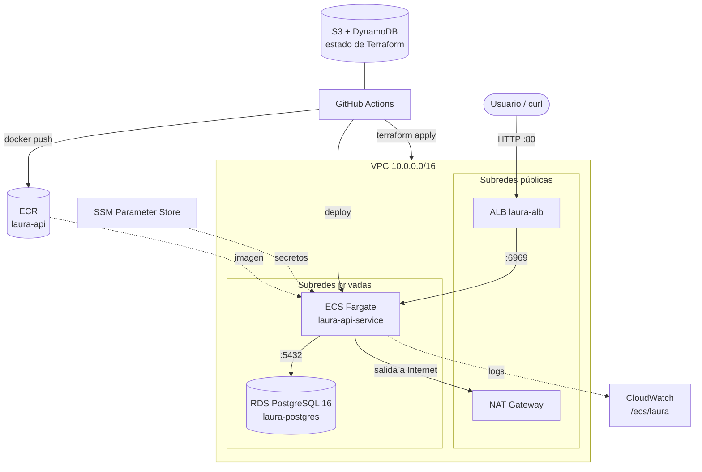

# lauracanceleatiempo · API de chefs y platos en AWS

API REST en **Spring Boot 4 (Java 25)** con **PostgreSQL**, desplegada en **AWS** con **Terraform** y **GitHub Actions**.
Cada `push` a `main` crea o actualiza la infraestructura y publica la versión nueva de la API, sin pasos manuales.

> 📊 **Presentación** con todo esto explicado slide por slide: **<https://sebastianzapatar.github.io/laurai/>** (código en [`docs/index.html`](docs/index.html)). Se navega con ← → y la tecla **M** abre el índice. Para publicarla en GitHub Pages, ver [la sección 17](#17-publicar-la-presentación-en-github-pages).

---

## Tabla de contenido

1. [Qué hace la API](#1-qué-hace-la-api)
2. [Arquitectura en AWS](#2-arquitectura-en-aws)
3. [Estructura del repositorio](#3-estructura-del-repositorio)
4. [Ejecutar en local](#4-ejecutar-en-local)
5. [Desplegar en AWS: resumen](#5-desplegar-en-aws-resumen)
6. [Parte A · Lo que creas en AWS](#6-parte-a--lo-que-creas-en-aws)
7. [Parte B · Lo que creas en GitHub](#7-parte-b--lo-que-creas-en-github)
8. [Parte C · Desplegar y verificar](#8-parte-c--desplegar-y-verificar)
9. [Cómo funciona el pipeline](#9-cómo-funciona-el-pipeline)
10. [Actualizar la aplicación: qué es automático y qué no](#10-actualizar-la-aplicación-qué-es-automático-y-qué-no)
11. [Terraform desde tu computador (opcional)](#11-terraform-desde-tu-computador-opcional)
12. [Destruir la infraestructura](#12-destruir-la-infraestructura)
13. [Costos](#13-costos)
14. [Solución de problemas](#14-solución-de-problemas)
15. [Referencia de configuración](#15-referencia-de-configuración)
16. [Limitaciones conocidas](#16-limitaciones-conocidas)
17. [Publicar la presentación en GitHub Pages](#17-publicar-la-presentación-en-github-pages)

---

## 1. Qué hace la API

Gestiona **chefs** y sus **platos**. Escucha en el puerto **6969**.

| Método | Ruta | Descripción |
|---|---|---|
| `GET` | `/api/chefs` | Lista todos los chefs |
| `GET` | `/api/chefs/{id}` | Un chef por id |
| `POST` | `/api/chefs` | Crea un chef |
| `GET` | `/api/dishes` | Lista todos los platos |
| `GET` | `/api/dishes/{id}` | Un plato por id |
| `GET` | `/api/dishes/chef/{chefId}` | Platos de un chef |
| `POST` | `/api/dishes` | Crea un plato |
| `GET` | `/actuator/health` | Estado de la app (lo usa el balanceador) |

**Crear un chef**

```json
POST /api/chefs
{ "name": "Laura", "specialty": "Colombiana", "description": "Cocina paisa" }
```

| Campo | Regla |
|---|---|
| `name` | obligatorio, 2–120 caracteres |
| `specialty` | opcional, máx. 80 |
| `description` | opcional, máx. 100 |

**Crear un plato**

```json
POST /api/dishes
{ "name": "Bandeja paisa", "price": 35000, "chefId": 1 }
```

| Campo | Regla |
|---|---|
| `name` | obligatorio, 2–140 caracteres |
| `price` | obligatorio, mayor que 0 |
| `chefId` | obligatorio, positivo, debe existir |

**Errores**: si un id no existe, la respuesta es `404`; si el body no cumple las reglas, es `400` con el detalle por campo:

```json
{ "timestamp": "…", "status": 400, "fieldsErrors": { "name": "…" } }
```

> ⚠️ **La API no tiene autenticación.** Keycloak se retiró para simplificar el despliegue: cualquiera que conozca la URL puede crear chefs y platos. Ver [Limitaciones conocidas](#16-limitaciones-conocidas).

---

## 2. Arquitectura en AWS

Todo vive en la región **`us-east-2` (Ohio)**, repartido en 2 zonas de disponibilidad.



Cómo viaja una petición:

1. El usuario llama al **ALB** (Application Load Balancer), el **único** componente con IP pública.
2. El ALB la reenvía al contenedor en **ECS Fargate**, que vive en una subred **privada**.
3. El contenedor consulta **RDS PostgreSQL**, también privado: solo el contenedor puede hablarle.
4. Para descargar la imagen de **ECR** y leer los secretos de **SSM**, el contenedor sale a Internet por el **NAT Gateway**.

### Servicios de AWS que se usan

| Servicio | Para qué sirve aquí | Dónde se define |
|---|---|---|
| **VPC**, subredes, Internet Gateway, NAT Gateway | Red aislada: lo público (ALB, NAT) separado de lo privado (ECS, RDS) | `terraform/modules/network` |
| **Security Groups** | Firewall encadenado: Internet → ALB (80/443) → ECS (6969) → RDS (5432) | `modules/ecs`, `modules/rds` |
| **ECR** | Guarda las imágenes Docker de la API (conserva las últimas 10) | `modules/ecr` |
| **ECS Fargate** | Ejecuta el contenedor sin administrar servidores; despliegues sin caída y rollback automático | `modules/ecs` |
| **ALB** | Recibe el tráfico HTTP y lo manda solo a tareas sanas (`/actuator/health`) | `modules/ecs` |
| **RDS PostgreSQL** | Base de datos `chefs_db` administrada (`db.t3.micro`, 20 GB cifrados) | `modules/rds` |
| **SSM Parameter Store** | Guarda cifrados la URL, el usuario y la contraseña de la BD; ECS los inyecta como variables de entorno | `modules/ssm` |
| **IAM** | Rol de ejecución (ECS descarga la imagen, lee SSM, escribe logs) y rol de tarea (vacío hoy) | `modules/ecs` |
| **CloudWatch Logs** | Logs del contenedor en `/ecs/laura` (30 días) + Container Insights | `modules/ecs` |
| **S3 + DynamoDB** | Estado remoto de Terraform y candado para evitar dos `apply` a la vez | `terraform/main.tf` (backend) |

---

## 3. Estructura del repositorio

```text
.
├── src/                          Código de la API (Spring Boot)
├── Dockerfile                    Build multi-stage: compila con Maven y corre con JRE 25
├── compose.yml                   PostgreSQL + API para desarrollo local
├── terraform/
│   ├── main.tf                   Orquesta los módulos + backend S3
│   ├── variables.tf              Región, nombre del proyecto, BD, CPU/RAM…
│   ├── outputs.tf                URL del ALB, URL de ECR, nombres de ECS
│   ├── terraform.tfvars.example  Plantilla para correr Terraform en local
│   └── modules/
│       ├── network/              VPC, subredes, IGW, NAT, tablas de rutas
│       ├── ecr/                  Repositorio de imágenes
│       ├── rds/                  PostgreSQL + su security group
│       ├── ssm/                  Parámetros SecureString
│       └── ecs/                  Cluster, task definition, service, ALB, IAM, logs
├── .github/workflows/
│   ├── aws-ecs.yml               Pipeline: Terraform + build + deploy (push a main)
│   └── destroy-infra.yml         Destruye todo (manual)
└── docs/
    ├── index.html                Presentación del proyecto (GitHub Pages)
    └── iam-policy-github-actions.json   Política IAM mínima para el pipeline
```

---

## 4. Ejecutar en local

### Requisitos

| Herramienta | Versión | Para qué |
|---|---|---|
| Docker (con Compose) | reciente | Levantar PostgreSQL y la API |
| Java (JDK) | 25 | Correr los tests y la app sin Docker |
| Git | cualquiera | Clonar y hacer push |

### 4.1 Correr los tests

Usan H2 en memoria, **no** necesitan Docker ni base de datos:

```bash
./mvnw test
```

### 4.2 Levantar todo con Docker Compose

```bash
docker compose up -d --build     # PostgreSQL en el puerto 5469 + API en el 6969
```

Probar:

```bash
curl localhost:6969/actuator/health
# {"groups":["liveness","readiness"],"status":"UP"}

curl -X POST localhost:6969/api/chefs \
  -H "Content-Type: application/json" \
  -d '{"name":"Laura","specialty":"Colombiana"}'

curl -X POST localhost:6969/api/dishes \
  -H "Content-Type: application/json" \
  -d '{"name":"Bandeja paisa","price":35000,"chefId":1}'

curl localhost:6969/api/dishes/chef/1
```

Apagar:

```bash
docker compose down        # conserva los datos
docker compose down -v     # borra también los datos de PostgreSQL
```

### 4.3 Correr la API sin Docker (opcional)

```bash
docker compose up -d postgres    # solo la base de datos
./mvnw spring-boot:run           # la API se conecta a localhost:5469
```

---

## 5. Desplegar en AWS: resumen

**Tú creas muy poco. Casi todo lo crea el pipeline.**

| Quién | Qué | Paso |
|---|---|---|
| 👤 **Tú, en AWS** | Cuenta de AWS + (recomendado) alerta de presupuesto | [A1](#a1-cuenta-región-y-alerta-de-costos) |
| | Usuario IAM `github-actions-laura` | [A2](#a2-crear-el-usuario-iam-del-pipeline) |
| | Permisos para ese usuario | [A3](#a3-darle-permisos-al-usuario) |
| | Access key (2 llaves) de ese usuario | [A4](#a4-crear-la-access-key) |
| 👤 **Tú, en GitHub** | Environment `production` | [B1](#b1-crear-el-environment-production) |
| | 3 secrets: `AWS_ACCESS_KEY_ID`, `AWS_SECRET_ACCESS_KEY`, `DB_PASSWORD` | [B2](#b2-agregar-los-3-secrets) |
| | *(solo en otra cuenta o en un fork)* renombrar bucket y tabla | [B3](#b3-solo-si-despliegas-en-otra-cuenta-o-desde-un-fork) |
| 🤖 **El pipeline** | Bucket S3, tabla DynamoDB, VPC, subredes, NAT, security groups, ECR, ECS, ALB, RDS, SSM, roles IAM de ECS, CloudWatch, imagen Docker y despliegue | [C1](#c1-hacer-push-a-main) |

> 🚫 **No crees a mano nada de la última fila.** Si, por ejemplo, creas desde la consola un repositorio ECR llamado `laura-api`, Terraform fallará con *"already exists"* porque ese recurso no está en su estado.

Orden recomendado: **A1 → A2 → A3 → A4 → B1 → B2 → (B3) → C1 → C2 → C3**.

---

## 6. Parte A · Lo que creas en AWS

### A1. Cuenta, región y alerta de costos

1. Entra a <https://console.aws.amazon.com/>. Si no tienes cuenta, pulsa *Create an AWS account*; te pedirá correo, tarjeta y verificación por teléfono.
2. **Selecciona la región Ohio.** Arriba a la derecha, en el selector de región, elige **US East (Ohio) `us-east-2`**.
   > Todo el proyecto vive en esa región. Si la consola está en otra, **no verás** el cluster, la base de datos ni el ALB y parecerá que no se creó nada.
3. **Crea una alerta de presupuesto** (recomendado). Encendida, esta infraestructura cuesta unos **3 USD por día**.
   - Ruta: **Billing and Cost Management → Budgets → Create budget**
   - *Use a template* → **Monthly cost budget**
   - Monto: por ejemplo **20 USD**
   - *Email recipients*: tu correo → **Create budget**

### A2. Crear el usuario IAM del pipeline

GitHub Actions necesita su propia identidad en AWS: un usuario **solo para máquinas**, con llaves que puedas revocar cuando quieras.

1. En la consola, busca **IAM** → **Users** → **Create user**.
2. **User name**: `github-actions-laura`.
3. **No** marques *"Provide user access to the AWS Management Console"*: este usuario nunca entra a la consola.
4. Pulsa **Next**. Llegas a la pantalla de permisos (paso A3).

### A3. Darle permisos al usuario

Elige **una** de las dos opciones.

#### Opción 1 · Rápida (cuenta de pruebas o de clase)

1. En *Permissions options* elige **Attach policies directly**.
2. Busca **`AdministratorAccess`** y márcala.
3. **Next** → **Create user**.

> ⚠️ Con esas llaves se puede hacer **cualquier cosa** en la cuenta. Úsala solo en una cuenta de pruebas.

#### Opción 2 · Solo los permisos necesarios (recomendada)

1. En otra pestaña: **IAM → Policies → Create policy**.
2. Abre la pestaña **JSON**, borra lo que hay y pega el contenido de [`docs/iam-policy-github-actions.json`](docs/iam-policy-github-actions.json).
3. **Next** → nombre: `laura-github-actions` → **Create policy**.
4. Vuelve a la creación del usuario → **Attach policies directly** → busca `laura-github-actions` → márcala → **Next** → **Create user**.

Qué permite cada bloque de la política:

| Sid | Para qué |
|---|---|
| `InfraestructuraDelProyecto` | Crear y borrar la red, ECS, ECR, RDS, SSM, ALB y logs |
| `RolesDeEcsDelProyecto` | Crear **solo** los roles `laura-*` y pasárselos a ECS |
| `RolesVinculadosAServicios` | La primera vez que la cuenta usa ECS, ELB o RDS, AWS crea un *service-linked role* |
| `EstadoDeTerraformEnS3` | Leer y escribir el `terraform.tfstate` en el bucket |
| `CandadoDeTerraformEnDynamoDB` | El candado (lock) de Terraform |

> ℹ️ `aws_permissions.pdf` (raíz del repo) es una versión anterior de esta lista y **le faltan permisos** que el pipeline sí usa (S3, DynamoDB, `iam:CreateServiceLinkedRole`, lifecycle policies de ECR…). Usa el JSON de `docs/`.

### A4. Crear la access key

1. **IAM → Users → `github-actions-laura`** → pestaña **Security credentials**.
2. Baja a **Access keys** → **Create access key**.
3. Caso de uso: **Application running outside AWS**. Si aparece una casilla de confirmación, márcala.
4. **Next** → descripción opcional (`github-actions`) → **Create access key**.
5. Copia los dos valores o pulsa **Download .csv file**:

| Valor en AWS | Se ve como | Irá al secret de GitHub |
|---|---|---|
| Access key ID | `AKIA…` (20 caracteres) | `AWS_ACCESS_KEY_ID` |
| Secret access key | 40 caracteres | `AWS_SECRET_ACCESS_KEY` |

> 🔑 **El secret access key se muestra una sola vez.** Si cierras la página sin copiarlo, borra esa access key y crea otra. **Nunca** lo pegues en el código ni en un commit.

**Opcional: comprobar que las llaves funcionan** (requiere [AWS CLI](https://docs.aws.amazon.com/cli/latest/userguide/getting-started-install.html)):

```bash
aws configure --profile laura
#   AWS Access Key ID:     AKIA…
#   AWS Secret Access Key: …
#   Default region name:   us-east-2
#   Default output format: json

aws sts get-caller-identity --profile laura
# "Arn": "arn:aws:iam::123456789012:user/github-actions-laura"   ← funcionan
```

Si responde `InvalidClientTokenId` o `SignatureDoesNotMatch`, las llaves están mal copiadas o la access key fue desactivada.

---

## 7. Parte B · Lo que creas en GitHub

### B1. Crear el environment `production`

Los dos jobs del workflow declaran `environment: production`; los secrets del paso B2 viven dentro de ese environment.

1. En el repositorio: **Settings → Environments → New environment**.
2. **Name**: `production` (en minúsculas y exacto).
3. **Configure environment**.
4. *(Opcional)* **Required reviewers**: agrega tu usuario si quieres **aprobar a mano** cada despliegue antes de que corra.

> Solo el dueño o un admin del repositorio ve **Settings**. Si el repositorio es de otra persona, haz un **fork** y sigue estos pasos en tu fork (y luego el paso B3).

### B2. Agregar los 3 secrets

En la misma pantalla del environment: **Environment secrets → Add environment secret**, una vez por cada fila:

| Name (exacto) | Value | De dónde sale |
|---|---|---|
| `AWS_ACCESS_KEY_ID` | `AKIA…` | Paso A4 |
| `AWS_SECRET_ACCESS_KEY` | los 40 caracteres | Paso A4 |
| `DB_PASSWORD` | una contraseña nueva que inventas tú | ver abajo |

**Cómo generar `DB_PASSWORD`:**

```bash
openssl rand -hex 16     # 32 caracteres hexadecimales: siempre válida para RDS
```

RDS exige 8–128 caracteres y **no** acepta `/`, `@`, `"` ni espacios. Guárdala también en tu gestor de contraseñas.

> ⚠️ **Escoge `DB_PASSWORD` una vez y no la cambies.** Terraform crea RDS con esa contraseña y luego **ignora** los cambios (`ignore_changes = [password]`). Si cambias el secret después, SSM recibe la nueva pero RDS sigue con la vieja, y la app **no podrá conectarse**. Si de verdad necesitas cambiarla, cámbiala también en RDS (*Modify → New master password*) con el mismo valor, o destruye y vuelve a crear todo.

> 🧹 Si existe un secret `KEYCLOAK_ISSUER_URI` de versiones anteriores, puedes borrarlo; ya no se usa.

> 💡 Alternativa: si no quieres usar environments, crea los 3 en **Settings → Secrets and variables → Actions → New repository secret**. GitHub los encuentra igual.

### B3. Solo si despliegas en otra cuenta o desde un fork

**Sáltate este paso** si despliegas en la misma cuenta de AWS de siempre.

Los nombres de bucket S3 son **únicos en todo el mundo**. `laura-tf-state-xyz89b` ya pertenece a la cuenta original, así que en otra cuenta la creación falla. El fallo es **silencioso**, porque el workflow usa `|| true`; lo que verás después es `terraform init` fallando con *AccessDenied* o *bucket does not exist*.

Cambia el sufijo `xyz89b` por uno tuyo en los 3 archivos que lo usan:

```bash
NUEVO=ana2026   # tu sufijo: solo minúsculas y números

grep -rl xyz89b terraform/main.tf \
  .github/workflows/aws-ecs.yml \
  docs/iam-policy-github-actions.json \
  | xargs sed -i '' "s/xyz89b/$NUEVO/g"     # en Linux: sed -i (sin '')

git commit -am "chore: bucket de estado propio"
```

Si usaste la **opción 2** del paso A3, actualiza también la política en IAM con los nombres nuevos.

En un fork, GitHub desactiva los workflows al principio: abre la pestaña **Actions** y pulsa **"I understand my workflows, go ahead and enable them"**.

---

## 8. Parte C · Desplegar y verificar

### C1. Hacer push a `main`

```bash
git add .
git commit -m "feat: mi cambio"
git push origin main
```

Eso es todo: el push dispara el pipeline `.github/workflows/aws-ecs.yml`.

> Los cambios que **solo** tocan `docs/` o archivos `.md` **no** disparan el pipeline (ver [sección 9](#9-cómo-funciona-el-pipeline)).

### C2. Seguir el pipeline

1. En GitHub abre la pestaña **Actions** → el run con tu mensaje de commit.
2. Verás dos jobs, uno después del otro:

| Job | Qué hace | Primera vez | Siguientes |
|---|---|---|---|
| 🏗️ **Infraestructura (Terraform)** | Crea o actualiza todo en AWS | ~10–15 min (RDS tarda) | ~1 min si no cambiaste `terraform/` |
| 🚀 **Build & Deploy** | Construye la imagen, la sube a ECR y despliega en ECS | ~5 min | ~5 min |

3. Cuando ambos estén en verde ✅, abre el run y baja al **Summary**. Ahí está la tabla **"🚀 Deploy exitoso!"** con la **URL de la API**:

```text
🌐 URL de la API   http://laura-alb-123456789.us-east-2.elb.amazonaws.com
📦 Imagen          …/laura-api:<sha del commit>
```

> 🔁 **No hagas dos pushes seguidos.** Si el primer run no ha terminado, el segundo queda bloqueado por el candado de DynamoDB (`Error acquiring the state lock`).

### C3. Verificar que todo funciona

Con la URL del Summary:

```bash
ALB=laura-alb-123456789.us-east-2.elb.amazonaws.com   # ← la tuya

curl http://$ALB/actuator/health
# {"groups":["liveness","readiness"],"status":"UP"}

curl -X POST http://$ALB/api/chefs \
  -H "Content-Type: application/json" \
  -d '{"name":"Laura","specialty":"Colombiana"}'

curl -X POST http://$ALB/api/dishes \
  -H "Content-Type: application/json" \
  -d '{"name":"Bandeja paisa","price":35000,"chefId":1}'

curl http://$ALB/api/dishes/chef/1
```

> El ALB puede tardar 1–2 minutos en marcar la tarea como sana después del deploy. Si recibes `503`, espera un momento y reintenta.

En la consola de AWS (región **Ohio**) deberías ver:

| Dónde | Qué deberías ver |
|---|---|
| **ECS → Clusters → `laura-cluster`** | Servicio `laura-api-service` con **1/1** tareas *Running* |
| **EC2 → Target groups → `laura-tg`** | 1 target **healthy** |
| **RDS → Databases** | `laura-postgres` en estado **Available** |
| **ECR → Repositories → `laura-api`** | Imagen con el tag del commit y `latest` |
| **CloudWatch → Log groups → `/ecs/laura`** | Logs del arranque de Spring Boot |

Ver los logs en vivo desde la terminal:

```bash
aws logs tail /ecs/laura --follow --region us-east-2 --profile laura
```

---

## 9. Cómo funciona el pipeline

### `aws-ecs.yml`: se ejecuta con cada push a `main`

```yaml
on:
  push:
    branches: [ "main" ]
    paths-ignore:          # cambios SOLO en documentación no despliegan
      - 'docs/**'
      - '**.md'
```

**Job 1 · Terraform**

1. Configura las credenciales de AWS con los secrets.
2. Crea, si no existen, el bucket S3 `laura-tf-state-xyz89b` (con versionado) y la tabla DynamoDB `laura-tf-locks-xyz89b`.
3. `terraform init` → `terraform validate`.
4. `terraform plan -var="db_password=${{ secrets.DB_PASSWORD }}"`.
5. `terraform apply` del plan.
6. Publica el DNS del ALB para el siguiente job.

**Job 2 · Build & Deploy** (solo si el job 1 terminó bien)

1. Login en ECR.
2. `docker build`: el `Dockerfile` compila con Maven dentro del contenedor.
3. `docker push` con dos tags: el SHA del commit y `latest`.
4. Descarga la última revisión de la task definition `laura-api-task` y le cambia la imagen por la nueva.
5. Despliega en ECS y **espera a que el servicio quede estable**.
6. Escribe la URL de la API en el Summary.

**¿Por qué Terraform no construye la imagen?** Terraform describe la **infraestructura**, que cambia poco; el pipeline publica **versiones de la app**, que cambian en cada commit. Por eso el servicio de ECS tiene `ignore_changes = [task_definition]`: Terraform no deshace lo que despliega el pipeline.

**Despliegues sin caída:** ECS arranca primero la tarea nueva (`maximum_percent = 200`) y solo apaga la vieja cuando la nueva pasa el health check (`minimum_healthy_percent = 100`). Si la nueva no arranca, el **circuit breaker** hace rollback a la versión anterior y la API sigue funcionando.

**Volver a ejecutar un run** (por ejemplo, después de corregir un secret): **Actions → el run → Re-run all jobs**. No hace falta otro push; el re-run lee los secrets actuales.

### `destroy-infra.yml`: solo manual

Ver [sección 12](#12-destruir-la-infraestructura).

---

## 10. Actualizar la aplicación: qué es automático y qué no

✅ **Se actualiza solo con un push a `main`:**

| Cambio | Qué pasa |
|---|---|
| Código Java, `pom.xml`, `Dockerfile` | Imagen nueva → despliegue sin caída |
| Archivos en `terraform/` (CPU, memoria, puertos, security groups, variables…) | Terraform aplica solo las diferencias |
| Secrets/variables de la task definition en Terraform | Se registra una revisión nueva y el job 2 la despliega |
| El propio workflow | El mismo push ya corre con la versión nueva |
| Entidades JPA nuevas o campos nuevos | Hibernate (`ddl-auto: update`) agrega tablas/columnas al arrancar |

❌ **No se actualiza solo:**

| Caso | Qué hacer |
|---|---|
| Push a otra rama o un pull request | Solo `main` despliega. Haz merge a `main`. |
| Cambios solo en `docs/` o `.md` | No despliegan, a propósito |
| Cambiar `DB_PASSWORD` | Cámbiala también en RDS (ver paso B2) |
| Cambiar `desired_count` | El servicio lo ignora; cámbialo en la consola de ECS o quita `desired_count` de `ignore_changes` |
| Renombrar o borrar columnas | Hibernate no lo hace; requiere migración manual (o Flyway/Liquibase) |
| Destruir la infraestructura | Nunca automático: workflow manual |

---

## 11. Terraform desde tu computador (opcional)

Útil para ver el `plan` antes de hacer push. Requiere **Terraform ≥ 1.5** y **AWS CLI** configurado (paso A4).

```bash
export AWS_PROFILE=laura
cd terraform
cp terraform.tfvars.example terraform.tfvars
# edita terraform.tfvars: db_password = el MISMO valor del secret DB_PASSWORD

terraform init       # usa el mismo backend S3 que el pipeline
terraform plan       # muestra qué cambiaría, sin tocar nada
terraform apply      # aplica (pide escribir "yes")

terraform output alb_dns_name
terraform output ecr_repository_url
```

> `terraform.tfvars` está en `.gitignore`: **nunca** lo subas.
>
> ⚠️ Tu computador y GitHub Actions comparten **el mismo estado** en S3. No hagas `apply` local mientras corre el pipeline.

Subir una imagen a mano (sin pipeline):

```bash
REPO=$(terraform output -raw ecr_repository_url)
aws ecr get-login-password --region us-east-2 \
  | docker login --username AWS --password-stdin ${REPO%/*}
docker build -t $REPO:latest ..
docker push $REPO:latest
aws ecs update-service --cluster laura-cluster \
  --service laura-api-service --force-new-deployment
```

---

## 12. Destruir la infraestructura

El NAT Gateway, el ALB y Fargate **cobran por hora aunque nadie use la API**. Al terminar de probar:

1. GitHub → **Actions** → **💣 Destruir Infraestructura (Terraform Destroy)** → **Run workflow**.
2. En el campo de confirmación escribe **`DESTRUIR`** (en mayúsculas) → **Run workflow**.
3. Espera ~10 minutos y comprueba en la consola (Ohio) que ya no están el cluster, la base de datos ni el ALB.

Desde tu computador, como alternativa:

```bash
cd terraform && terraform destroy -var="db_password=..."
```

| Se pierde | No se borra |
|---|---|
| La base de datos, **sin snapshot final** | El bucket S3 y la tabla DynamoDB del estado (los creó el workflow, no Terraform) |
| Todas las imágenes de ECR | El usuario IAM y su access key |
| La URL del ALB (el próximo deploy tendrá otra) | Los secrets de GitHub |

Para volver a desplegar basta con otro push a `main` (o **Re-run** del último run).
Si cierras el proyecto para siempre: borra el bucket y la tabla a mano y **desactiva la access key** en IAM.

---

## 13. Costos

Estimación mensual en `us-east-2` con 1 tarea y poco tráfico. Son valores aproximados: confírmalos en la [AWS Pricing Calculator](https://calculator.aws/).

| Servicio | Qué se cobra | ≈ USD/mes |
|---|---|---|
| NAT Gateway | Por hora + por GB procesado | ~33 |
| ECS Fargate | 0.5 vCPU + 1 GB, 24/7 | ~18 |
| ALB | Por hora + LCU | ~17 |
| IPv4 públicas | ALB (2) + NAT (1) | ~11 |
| RDS | `db.t3.micro` + 20 GB | ~15 (0 en free tier) |
| ECR, SSM, CloudWatch, S3, DynamoDB | Almacenamiento y peticiones | < 2 |
| **Total** | | **≈ 80–95** |

👉 Para una clase o una demo: despliega, prueba y **destruye el mismo día**.

---

## 14. Solución de problemas

Abre el run en **Actions**, entra al job en rojo y busca el mensaje en el step que falló.

| Mensaje / síntoma | Causa | Solución |
|---|---|---|
| `The security token included in the request is invalid` | Las llaves de los secrets no son válidas: access key borrada o desactivada, o mal copiada | Crea una access key nueva (A4), reemplaza los 2 secrets (B2) y **Re-run all jobs** |
| `Credentials could not be loaded` | Los secrets no existen con ese nombre o no están en el environment `production` | Revisa B1 y B2: nombres exactos |
| `InvalidClientTokenId` / `SignatureDoesNotMatch` | Llaves con espacios o incompletas | Pégalas de nuevo, sin espacios |
| `User … is not authorized to perform: X` | Al usuario IAM le falta el permiso `X` | Agrégalo a la política (A3) |
| `terraform init`: *AccessDenied* o *bucket does not exist* | El nombre del bucket pertenece a otra cuenta | Paso B3 |
| `MasterUserPassword is not a valid password` | `DB_PASSWORD` tiene caracteres prohibidos | Genera otra con `openssl rand -hex 16` |
| `… already exists` | El recurso se creó a mano, o quedó de un run viejo fuera del estado | Bórralo en la consola o haz `terraform import` |
| `Error acquiring the state lock` | Otro run en curso, o un run cancelado dejó el candado | Espera; si nada corre: `terraform force-unlock <LOCK_ID>` |
| Job 2: *service did not stabilize* o rollback | La app no arranca (BD, contraseña, memoria…) | `aws logs tail /ecs/laura --follow` |
| La URL responde `503` | No hay tareas sanas en el target group | ECS → servicio → pestaña **Events** + logs de CloudWatch |
| La app no conecta a la BD después de cambiar `DB_PASSWORD` | RDS sigue con la contraseña vieja | Ver la advertencia del paso B2 |
| No veo ningún recurso en la consola | Estás en otra región | Cambia a **US East (Ohio)** |

---

## 15. Referencia de configuración

### Variables de entorno de la app

| Variable | Default (local) | En AWS viene de |
|---|---|---|
| `SPRING_DATASOURCE_URL` | `jdbc:postgresql://localhost:5469/chefs_db` | SSM `/laura/prod/SPRING_DATASOURCE_URL` |
| `SPRING_DATASOURCE_USERNAME` | `postgres` | SSM `/laura/prod/SPRING_DATASOURCE_USERNAME` |
| `SPRING_DATASOURCE_PASSWORD` | `postgres` | SSM `/laura/prod/SPRING_DATASOURCE_PASSWORD` |
| `SPRING_PROFILES_ACTIVE` | — | `prod` (task definition) |
| `SPRING_JPA_SHOW_SQL` | `true` | — |

En local también puedes ponerlas en un archivo `.env` (ver `.env.template`); está en `.gitignore`.

### Variables de Terraform (`terraform/variables.tf`)

| Variable | Default | Descripción |
|---|---|---|
| `aws_region` | `us-east-2` | Región de AWS |
| `project_name` | `laura` | Prefijo de todos los recursos |
| `environment` | `prod` | Entorno (forma parte de la ruta en SSM) |
| `db_name` | `chefs_db` | Nombre de la base de datos |
| `db_username` | `postgres` | Usuario maestro de RDS |
| `db_password` | — (**obligatoria**) | Viene del secret `DB_PASSWORD` |
| `container_port` | `6969` | Puerto de la app |
| `task_cpu` | `512` | CPU de la tarea (512 = 0.5 vCPU) |
| `task_memory` | `1024` | Memoria de la tarea en MB |
| `desired_count` | `1` | Tareas a mantener (solo al crear el servicio) |

> Si cambias `project_name` o `aws_region`, actualiza también los valores fijos del bloque `env:` de `.github/workflows/aws-ecs.yml` y la región del backend en `terraform/main.tf`.

### Outputs de Terraform

| Output | Contenido |
|---|---|
| `alb_dns_name` | URL pública de la API |
| `ecr_repository_url` | Repositorio para `docker push` |
| `ecs_cluster_name` / `ecs_service_name` | Nombres para `aws ecs …` |
| `rds_endpoint` | Endpoint de la BD (sensible) |

---

## 16. Limitaciones conocidas

Decisiones tomadas para que el proyecto sea sencillo de desplegar en una clase. **No** es una configuración de producción:

- **Sin autenticación**: se quitó Keycloak. Para producción habría que agregar Amazon Cognito, API Gateway con autorizadores, o volver a un proveedor OIDC.
- **Solo HTTP (puerto 80)**: el security group del ALB abre el 443, pero no hay listener HTTPS. Se necesita un certificado de ACM y un dominio.
- **RDS sin backups ni Multi-AZ** (`backup_retention_period = 0`, `multi_az = false`, `skip_final_snapshot = true`).
- **`engine_version = "16.6"` fijo**: cuando AWS retire esa versión menor, el `apply` fallará. Se puede cambiar a `"16"`.
- **Llaves de acceso estáticas** en GitHub: lo ideal es **OIDC** entre GitHub y AWS, que no requiere llaves.
- **JaCoCo 0.8.12 no soporta Java 25**, así que `./mvnw verify` falla en el reporte de cobertura (`./mvnw test` funciona). Se arregla subiendo a 0.8.14.

---

## 17. Publicar la presentación en GitHub Pages

La presentación está en `docs/index.html`, la ruta que GitHub Pages sirve por defecto cuando publicas desde la carpeta `/docs`.

1. En el repositorio: **Settings → Pages**.
2. En **Build and deployment → Source** elige **Deploy from a branch**.
3. **Branch**: `main`, carpeta **`/docs`** → **Save**.
4. Espera 1–2 minutos. La URL aparece arriba en esa misma pantalla:
   **<https://sebastianzapatar.github.io/laurai/>**

Cada push que cambie `docs/` actualiza la página automáticamente. Ese push **no** dispara el despliegue en AWS, gracias al `paths-ignore` del workflow.

> En un repositorio **privado**, GitHub Pages requiere un plan de pago (GitHub Pro, Team o Enterprise). En uno público es gratis.
